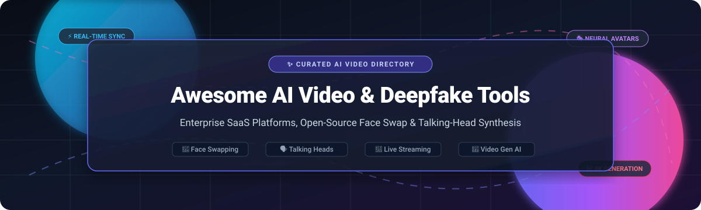

# 🎬 Awesome AI Video & Deepfake Tools 🎭

**Curated Directory of State-of-the-Art AI Video Generation, Real-Time Face Swapping, Lip-Syncing, and Talking-Head Synthesis**  

*Explore industry-leading enterprise SaaS tools alongside self-hosted open-source neural frameworks.*

📅 **Last updated: October 2026**

---

## 📌 Introduction & SEO Overview

Welcome to the ultimate curated list of **AI Video & Deepfake Tools**. Whether you are an AI researcher, creative technologist, visual effects (VFX) artist, or developer building production video pipelines, this repository catalogs cutting-edge solutions across:
- 🔄 **Face Swapping & Deepfake Generation**: Single-shot image swapping, real-time webcam streaming, and custom face-model training.
- 🗣️ **Talking-Head & Audio-Driven Animation**: Realistic lip-synchronization, expressive 3D head motion, and emotional audio-to-video synthesis.
- 🎥 **Text-to-Video & Image-to-Video Generation**: High-fidelity foundation models producing cinematic diffusion and autoregressive video clips.
- ⚡ **Live-Streaming Virtual Avatars**: Low-latency WebRTC and OBS-compatible virtual webcam deepfakes for real-time broadcasts.

---

## 📑 Table of Contents

- [📊 Sector Overview & Market Dynamics](#-sector-overview--market-dynamics)
- [🏢 SaaS / Hosted Platforms](#-saas--hosted-platforms)
- [💻 Open-Source GitHub Projects](#-open-source-github-projects)
- [🌟 Star History](#-star-history)
- [🤝 How to Contribute](#-how-to-contribute)
- [💖 Support](#-support)
- [⚖️ Disclaimer & Ethical Use](#️-disclaimer--ethical-use)

---

## 📊 Sector Overview & Market Dynamics

The global AI video generation and synthetic media sector is projected to reach approximately **$950 million to $1.8+ billion in 2026**, expanding at a 19–20% CAGR toward **$3.4+ billion by 2032**. 

The sector exhibits **high fragmentation with intense vertical competition**:
- Rather than a winner-take-all monopoly, foundational model builders (*Runway, OpenAI Sora, Google Veo, Kuaishou Wan/Kling*) power raw generation, while application-layer specialists (*Synthesia, HeyGen, D-ID*) capture structured corporate workflows (learning & development, personalized outbound sales, conversational customer support).
- Simultaneously, a vibrant open-source ecosystem provides accessible, transparent alternatives for developers requiring zero vendor lock-in, on-premise security, and unconstrained real-time streaming capability.

---

## 🏢 SaaS / Hosted Platforms

| Platform | Valuation / Revenue | Starting Price | Free Tier / Trial Limits | Key Capabilities & Highlights |
| :--- | :--- | :--- | :--- | :--- |
| **[Runway](https://runwayml.com/)** | **$5.3B Valuation** (~$200M ARR) | $12/mo (billed annually) or $15/mo | **125 one-time credits** (~10s video generation lifetime); no monthly refresh, watermark included, non-commercial only | Gen-3/Gen-4 video models, Act-One performance capture, motion brush. |
| **[Synthesia](https://www.synthesia.io/)** | **$4.0B Valuation** (~$100M+ ARR) | $18/mo (billed annually) or $29/mo (Starter) | **Free forever plan**: Up to 3 mins/mo (~1,200 credits), Synthesia watermark, video downloads disabled | Enterprise standard for corporate L&D; 230+ avatars, 140+ languages, studio voice cloning. |
| **[HeyGen](https://www.heygen.com/)** | **$500M Valuation** (~$200M ARR) | $24/mo (billed annually) or $29/mo (Creator) | **Free forever plan**: 1–3 free videos/mo (up to 1 min max per video), 720p sharing link, watermark included | Avatar IV expressive talking heads, automated video translation, personalized outbound videos. |
| **[Pika](https://pika.art/)** | **$470M Valuation** (~$135M Total Funding) | $8/mo (billed annually) or $10/mo (Starter) | **Free forever plan**: 0 recurring monthly credits (introductory trial credits only), 480p/watermarked, non-commercial only | Pikaffects for surreal creative transformations, text-to-video, image-to-video generation. |
| **[DeepBrain AI](https://www.deepbrain.io/)** | **$180M Valuation** (~$10M–$13M ARR) | $24/mo (billed annually) or $30/mo (Personal) | **Free trial**: 1 project/3 video exports total, 720p export limit, mandatory watermark | AI Studios for text-to-video, conversational LiveAvatars, AI Kiosk hardware integration. |
| **[D-ID](https://www.d-id.com/)** | **~$150M Valuation** (~$33M ARR) | $5.90/mo (billed annually) or $9.90/mo (Lite) | **14-day free trial**: Up to 3 minutes of generated video or 10 min streaming agents, D-ID watermark | Photo-to-talking-avatar synthesis, Creative Reality Studio, low-latency WebRTC live agents. |
| **[Hour One](https://hourone.ai/)** | **~$50M+ Valuation** (~$25M Total Funding) | $25/mo (billed annually) or $30/mo (Lite) | **Free trial**: 3 minutes of video generation total, viewable via link only, platform watermark | Virtual presenter avatars, text-to-video, interactive SCORM courses & brand templates. |
| **[Colossyan](https://www.colossyan.com/)** | **~$40M–$50M Valuation** (~$28M Total Funding) | $47/mo (billed annually) or $59/mo (Professional) | **14-day free trial** + Starter tier: Up to 20 minutes/mo (standard NEO models only), Colossyan watermark, SCORM export disabled | Workplace learning and L&D focus, interactive video branching, auto-translation. |
| **[Elai.io](https://elai.io/)** | **Acquired by Panopto** (~$1.3M Pre-Acq ARR) | $23/mo (billed annually) or $29/mo (Creator) | **Free forever plan**: 1 minute render credit pool total (account lifetime), max 3 slides per video, 60s speech/slide | PowerPoint-to-video conversion, custom avatar creation, 80+ stock avatars. |
| **[Rephrase.ai](https://www.rephrase.ai/)** | **Acquired by Adobe** ($13.9M Prior Funding) | $25/mo (Personal baseline prior to acquisition) | **Free trial**: 3 trial video credits, link sharing only, watermark included | Digital avatars and personalized video marketing engines at scale (integrated into Adobe ecosystem). |

---

## 💻 Open-Source GitHub Projects

*Ranked in descending order by GitHub_Stars ⭐. Each repository includes real-time social Stars_Badges linking directly to that repository's stargazers.*

| Project & Repository | GitHub_Stars | Focus Category | Architecture & Highlights |
| :--- | :---: | :--- | :--- |
| **[Deep-Live-Cam](https://github.com/hacksider/Deep-Live-Cam)** |  | Real-Time Live Face Swap | **The #1 most starred real-time face swap tool**. 3-click workflow (select face → select camera → live). Supports Mouth Mask, multi-face mapping, OBS virtual camera, Inswapper (128px) and HyperSwap (256px). Cross-platform execution (CUDA, CoreML, DirectML, OpenVINO). |
| **[DeepFaceLive](https://github.com/iperov/DeepFaceLive)** |  | Real-Time Streaming Deepfakes | Optimized real-time face swap for PC streaming and live video calls. Low latency pipeline with custom model support. |
| **[FaceFusion](https://github.com/facefusion/facefusion)** |  | Face Swap & Face Enhancement | **The next-generation face swapper and enhancer**. Highly actively maintained, intuitive modern GUI, headless CLI batch processing, CUDA/CoreML/ROCm acceleration, face restoration, and multi-target swapping. |
| **[DeepFaceLab](https://github.com/iperov/DeepFaceLab)** |  | Cinema-Grade Face Replacement | The industry standard open-source framework for high-fidelity offline deepfakes. Custom model training per face pair; reference benchmark for cinema, TV, and research VFX. |
| **[LivePortrait](https://github.com/KwaiVGI/LivePortrait)** |  | Efficient Portrait Animation | High-quality, ultra-fast portrait animation with stitch and retargeting control for realistic eye and lip movements from video driving signals. |
| **[SadTalker](https://github.com/OpenTalker/SadTalker)** |  | Talking-Head Generation | CVPR 2023 presentation for stylized audio-driven single-image talking face animation using 3D motion coefficients. |
| **[Wav2Lip](https://github.com/Rudrabha/Wav2Lip)** |  | Audio-to-Video Lip-Sync | ACM Multimedia 2020 paper. Synchronizes lip movements in any pre-recorded video to match any arbitrary target speech audio file with exceptional precision. |
| **[CogVideo](https://github.com/THUDM/CogVideo)** |  | Text-to-Video Diffusion | Advanced open text-to-video foundation model family from THUDM (CogVideoX), offering transformer-based diffusion video synthesis. |
| **[HunyuanVideo](https://github.com/tencent/HunyuanVideo)** |  | Foundation Video Diffusion | Tencent's cutting-edge open-source video generation model with over 13B parameters, delivering cinematic quality text-to-video generation. |
| **[FaceChain](https://github.com/modelscope/FaceChain)** |  | Personalized Portrait & Video | Deep-learning toolchain for generating digital personal portraits, avatars, and character videos from minimal source portrait uploads. |
| **[Hallo](https://github.com/fudan-generative-vision/hallo)** |  | Portrait Image Animation | Hierarchical audio-driven visual synthesis for portrait image animation, generating lifelike expressions and head poses from speech audio. |
| **[Rope](https://github.com/Hillobar/Rope)** |  | GUI Face Swapping | High-performance, feature-packed graphical user interface for instant offline face swapping on images and videos. |
| **[SimSwap](https://github.com/neuralchen/SimSwap)** |  | Generalized Face Swapping | ACM Multimedia 2020 framework utilizing feature-matching loss to preserve facial identity across challenging poses, expressions, and occlusions. |
| **[AniPortrait](https://github.com/Zejun-Yang/AniPortrait)** |  | Audio & Pose-Driven Video | Audio-driven and landmark-guided portrait video generation framework capable of synthesizing natural facial expressions and fluid head movements. |
| **[EchoMimic](https://github.com/BadToBest/EchoMimic)** |  | Lifelike Audio-Driven Avatars | Lifelike audio-driven portrait animation with editable landmark conditions, preserving visual identity and emotional expressiveness. |
| **[VGen](https://github.com/ali-vilab/VGen)** |  | Video Generation Ecosystem | Alibaba research codebase for video generation, synthesizing controllable text-to-video, video-to-video, and stylized video animation. |
| **[Rope-Live](https://github.com/argenspin/Rope-Live)** |  | Live Stream Face Swap | Community fork of Rope customized specifically for real-time live streaming integration with support for DeepFaceLive pipelines. |
| **[face2face](https://github.com/SocAIty/face2face)** |  | REST API & Batch Face Swap | Web-ready API microservice for swapping faces in photos and videos, creating facial embeddings, and automated batch processing. |
| **[faceoff](https://github.com/thebiglaskowski/faceoff)** |  | Gradio Face Swapper | Modular face swapper supporting Img2Img, Img2GIF, and Img2MP4 with TensorRT acceleration and Real-ESRGAN/HAT 4× upscaling. |

---

### 🎨 Community Integrations & ComfyUI Nodes

- **[Roop-Unleashed](https://huggingface.co/neziiio/roop-unleashed)** — Uncensored browser GUI fork featuring multi-face selection, batch processing, GFPGAN/CodeFormer restoration, and webcam live fake cam.
- **[ComfyUI-LivePortraitKJ](https://github.com/kijai/ComfyUI-LivePortraitKJ)** — Native ComfyUI nodes for LivePortrait, enabling modular node graph integration with SDXL and Flux pipelines.
- **[ReActor](https://github.com/Gourieff/sd-webui-reactor)** — Fast face swap extension node for Stable Diffusion WebUI and ComfyUI workflows.
- **[Deepfakes Overview](https://github.com/angeligareta/deepfakes-overview)** — Research survey and academic bibliography covering computer vision deepfake techniques.
- **[AI Technology Resources Hub](https://github.com/NadavIs56/AI_Technology_Resources_Hub)** — Curated repository of machine learning codebases, checkpoints, and face swapping guides.

---

## 📈 Star History

---

## 🤝 How to Contribute

Contributions are warmly welcomed! Help keep this ecosystem comprehensive, accurate, and up to date.

1. 🍴 **Fork the repository**.
2. 🌿 **Create a new branch**: `git checkout -b feature/add-new-tool`
3. 📝 **Add your entry to `README.md`**: Follow the established table formatting (Name, Repository URL, Pricing / Stars_Badge, Limits / Category, Highlights).
4. 🚀 **Submit a Pull Request** with a concise description of the platform or library.

---

## 💖 Support

If you find this repository valuable for your creative projects, research, or enterprise tooling:

- ⭐ **Star this repository** to help others discover it!
- 🍴 **Fork it** to contribute additions or share customized workflows.
- 📣 **Share it** on X / Twitter, LinkedIn, and Discord communities.
- ☕ **Sponsor & Buy a Coffee**: Support ongoing curation and maintenance via the **[GitHub Sponsors Dashboard](https://github.com/sponsors/ishandutta2007)**.

Thank you to all open-source contributors, researchers, and creators pushing the frontier of generative video! 🚀

---

## ⚖️ Disclaimer & Ethical Use

- 🛡️ **Consent & Legality**: AI video synthesis and deepfake technologies **must strictly comply** with all applicable consent laws, right of publicity statutes, and data privacy regulations (e.g., GDPR, CCPA, EU AI Act Article 50). **Never create, distribute, or publish non-consensual deepfakes of any individual.**
- 📜 **Licensing**: Models such as Inswapper are strictly restricted to **non-commercial academic research**. Always review licensing agreements (GPL, AGPL, CreativeML OpenRAIL, proprietary) before commercial deployment.
- 🏷️ **Watermarking & Transparency**: Generated media should be prominently disclosed as synthetic or AI-generated to maintain transparency across public and commercial broadcasts.
- ⚙️ **Dual-Use Responsibility**: Facial synthesis is a dual-use technology. Ensure safe, ethical, and responsible usage across all production environments.

---

<b>Made with ❤️ for developers, creators, and AI researchers shaping the future of synthetic video.</b>

